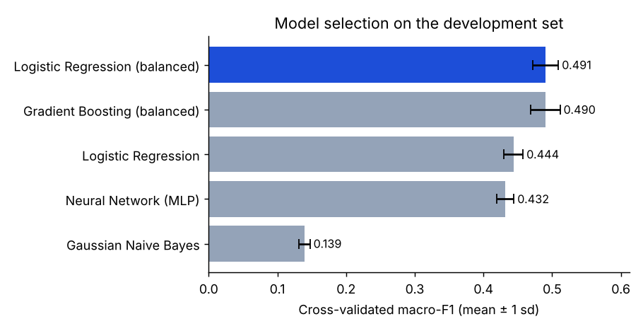
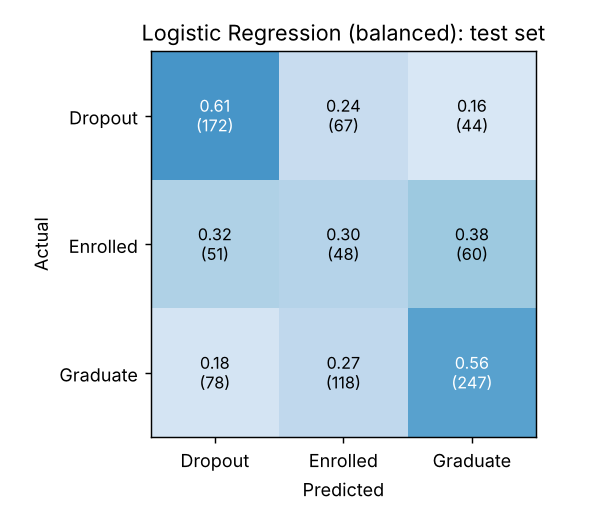
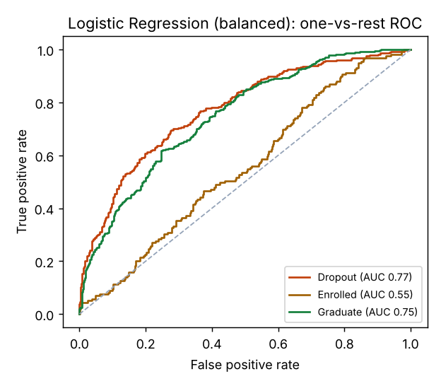
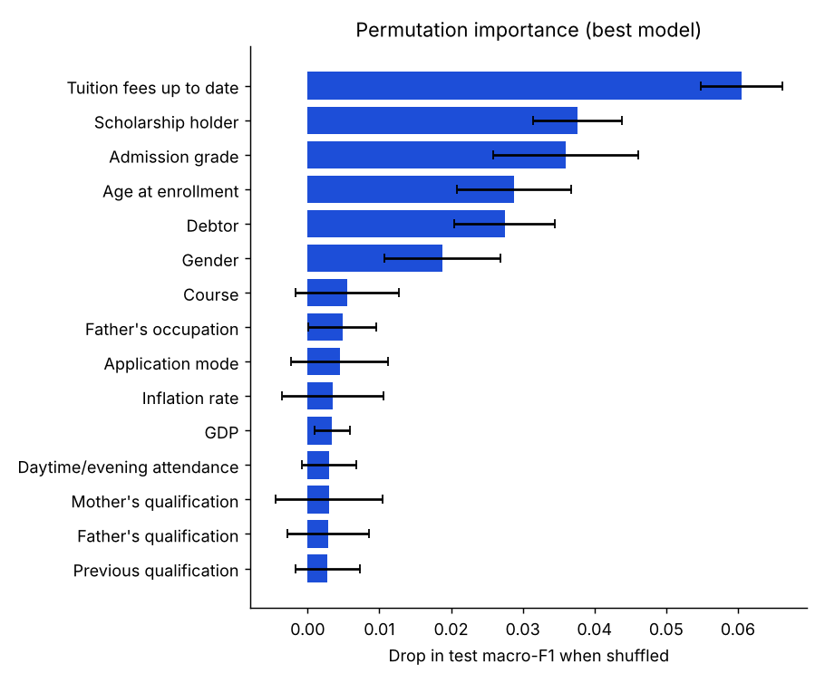
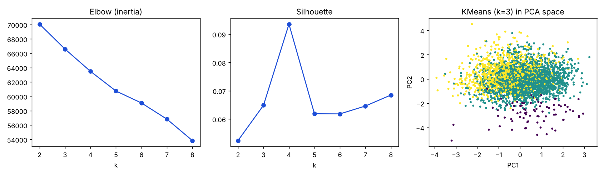

# Academic Success Prediction

[](https://github.com/roy032/academic-success-prediction/actions/workflows/ci.yml)


Predicts whether a student will **drop out, stay enrolled, or graduate**, from information available at enrollment (demographics, prior education, finances, macro-economics). The project is a tested Python package with a reproducible training pipeline, cross-validated model selection, uncertainty estimates on test metrics, an HTTP inference API and a Docker image.

```
asp train  ──►  artifacts/{model.joblib, metrics.json, results.md, figures/}  ──►  asp serve / docker run
```

## Quick start

```bash
pip install -e ".[dev]"     # or: make install
make test                   # 34 tests, ~30 s
asp train                   # synthetic data with the UCI schema, no download needed
asp train --data data.csv   # the real UCI file
asp serve                   # http://127.0.0.1:8000/docs
```

Docker (trains during the build, then serves):

```bash
docker build -t academic-success .                                   # synthetic data
docker build --build-arg DATA=data.csv -t academic-success .         # real data in the build context
docker run -p 8000:8000 academic-success
curl -X POST localhost:8000/predict -H 'Content-Type: application/json' \
     -d '{"students": [{"Marital status": 1, "Course": 9500, "...": "..."}]}'
```

## Data

The UCI [Predict Students' Dropout and Academic Success](https://archive.ics.uci.edu/dataset/697) dataset: 4,424 students, 36 features, three classes (32% Dropout, 18% Enrolled, 50% Graduate). It is not redistributed in this repository. Both the semicolon-delimited UCI file and the comma-delimited course variant used in the original notebook are accepted.

So the pipeline, tests and CI run without the file, `academic_success.data.make_synthetic` generates students with the same columns, code values and class balance, with outcomes driven by a known latent risk score. **All numbers on this page that are not explicitly labelled "real data" come from synthetic data** and validate the engineering, not the science.

By default the 12 `Curricular units ...` semester columns are dropped, so the model uses only enrollment-time information (24 features). `--include-curricular` keeps them.

## Methodology

| Step | What | Why |
|---|---|---|
| Split | Stratified 80/20 development/test split, made before anything is fit | The test set is used exactly once, at the end |
| Preprocessing | Median imputation + standardisation for numeric columns; mode imputation + one-hot encoding for the 9 integer-coded nominal columns (`Course`, `Application mode`, ...) | Codes such as `Course=9500` have no order; treating them as numbers (as the notebook did) is a modelling error. Rare codes are grouped and unseen codes are handled at inference |
| Outliers | Rows with \|z\| > 4 on the 7 continuous columns are dropped from **training folds only** | z-scores on category codes or binary flags are meaningless; evaluation rows are never dropped |
| Leakage control | Every fitted step lives inside one scikit-learn `Pipeline` that is re-fit inside each CV fold | No validation or test statistics reach training |
| Model selection | 5-fold stratified CV macro-F1 on the development set | A single validation split was within noise between models; CV gives mean ± sd |
| Metric | Macro-F1 (plus accuracy, balanced accuracy, one-vs-rest ROC-AUC, log loss) | *Enrolled* is a minority class; accuracy rewards ignoring it |
| Uncertainty | 1,000-sample bootstrap 95% CI on test accuracy and macro-F1 | Single-number test scores hide ±3 points of noise at n=885 |
| Explainability | Permutation importance on the test set, scored by macro-F1 | Model-agnostic, works for the whole pipeline |
| Unsupervised | KMeans (k = 2..8) with elbow and silhouette, PCA view, cluster-vs-outcome crosstab | Kept from the original analysis |

Models compared: logistic regression (plain and class-balanced), Gaussian naive Bayes, an MLP (128, 64), and class-balanced histogram gradient boosting.

## Results

### Synthetic data (reproduced by CI on every push)

| Model | CV macro-F1 (5-fold) | Test acc | Test macro-F1 | Test ROC-AUC |
|---|---|---|---|---|
| **Logistic Regression (balanced)** (selected) | 0.491 ± 0.018 | 0.528 | 0.485 | 0.692 |
| Gradient Boosting (balanced) | 0.490 ± 0.022 | 0.534 | 0.480 | 0.700 |
| Logistic Regression | 0.444 ± 0.014 | 0.614 | 0.449 | 0.693 |
| Neural Network (MLP) | 0.432 ± 0.012 | 0.603 | 0.434 | 0.709 |
| Gaussian Naive Bayes | 0.139 ± 0.008 | 0.195 | 0.140 | 0.608 |

Selected model test macro-F1 95% bootstrap CI: [0.455, 0.516]. Permutation importance recovers the drivers the generator actually uses (tuition status, scholarship, admission grade, age, debtor, gender), which is a useful end-to-end correctness check.

| | |
|---|---|
|  |  |
|  |  |



### Real data (earlier leakage-free script, single validation split)

Measured on the UCI file with the previous `train.py` (numeric treatment of category codes, single 64/16/20 split). Re-run `asp train --data <file>` to get the current pipeline's numbers with CV and confidence intervals.

| Features | Best model | Test acc | Test macro-F1 |
|---|---|---|---|
| Enrollment-time (24) | Logistic Regression (balanced) | 0.516 | 0.486 |
| + semester results (36) | Logistic Regression (balanced) | 0.721 | 0.680 |

Takeaways: at enrollment time *Enrolled* is barely predictable, and plain models reach ~0.6 accuracy by almost never predicting it. Class balancing trades accuracy for macro-F1, which is why selection uses macro-F1. Adding first-year results lifts macro-F1 to ~0.68, so an early-warning system should re-score students after their first semester.

The original notebook (`notebooks/01_eda_and_first_pass.ipynb`) scaled and removed outliers on the full dataset before splitting, so its numbers (test accuracy 0.636 for logistic regression) are optimistic and not comparable.

## Inference API

| Endpoint | Description |
|---|---|
| `GET /health` | Liveness, selected model, training timestamp |
| `GET /schema` | Expected feature names and class labels |
| `POST /predict` | Batch of up to 1,000 students → predicted class + class probabilities for each |

Missing values (`null`) are imputed by the pipeline. Missing *columns* return HTTP 422 with the names of the absent features. Interactive docs are served at `/docs`.

Batch scoring without a server: `asp predict students.csv --model artifacts/model.joblib` (one JSON line per row).

## Engineering

- **Package**: `src/` layout, `pyproject.toml`, `asp` console script, type hints throughout.
- **Tests**: 34 pytest tests at 98% line coverage, covering schema handling, a leakage check on the preprocessor, outlier logic, every model, CV and bootstrap maths, determinism (two runs with the same seed are identical), a beat-the-baseline check, the API (happy path and validation errors) and the CLI.
- **CI** (`.github/workflows/ci.yml`): ruff lint + format check; tests on Python 3.10, 3.11, 3.12 with a 90% coverage floor; a training run whose results table is posted to the job summary and whose artifacts are uploaded; a Docker build plus a live smoke test of the container.
- **Reproducibility**: every random step is seeded; `model.joblib` stores the fitted pipeline with its feature list, config, library versions and training time.
- **Container**: multi-stage build, no training data in the final image, non-root user, health check.
- **Hygiene**: pre-commit (ruff, nbstripout, large-file guard), `Makefile`, `.gitignore` that keeps data out of git.
- **Model card**: [`docs/MODEL_CARD.md`](docs/MODEL_CARD.md) covers intended use, limitations and fairness considerations.

## Project structure

```
├── src/academic_success/
│   ├── data.py        # loading, schema, synthetic generator
│   ├── pipeline.py    # preprocessing + model registry, outlier filter
│   ├── evaluate.py    # metrics, cross-validation, bootstrap CIs
│   ├── train.py       # end-to-end training and artifact writing
│   ├── plots.py       # figures
│   ├── predict.py     # Predictor: load bundle, validate input, score
│   ├── serve.py       # FastAPI app
│   └── cli.py         # `asp train | predict | serve`
├── tests/             # pytest suite
├── notebooks/         # original EDA + first-pass notebook
├── docs/              # model card, figures
├── Dockerfile, Makefile, pyproject.toml, .github/workflows/ci.yml
```
